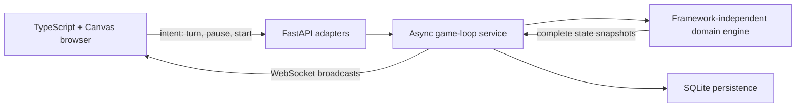

# Snakebite Reimagined

The first playable browser build of a modern Apple IIe-inspired Snakebite game:

- Python 3.15 and FastAPI backend
- Framework-independent, typed game engine
- Autonomous server game loop and authoritative WebSocket broadcasts
- Player-selectable snake speed, levels 1 to 5, for accessible play
- Selectable arrow-key, WASD, or either-scheme steering
- Zero to two bouncing perilous plums as a second difficulty dial
- Fifteen-apple levels with accelerating snake growth and progressive spawning
- Ten handcrafted level mazes ending in a level-10 trophy victory
- Web Audio sound cues modelled on the original single-speaker beeps
- Idle demo autoplay at randomized difficulty levels
- TypeScript, Vite, and Canvas browser client
- Keyboard and touch-friendly controls
- SQLite game, player, and score persistence
- Pytest and Ruff development tooling
- Architecture and learning notes in `docs/`

## Choosing a speed

Snakebite is meant to stay playable at any reaction speed, so the pace is an
explicit setting rather than a hidden constant. Pick a level before starting a
new game:

| Level | Name | Seconds per cell |
| --- | --- | --- |
| 1 | STROLL | 0.40 |
| 2 | EASY | 0.32 |
| 3 | STEADY | 0.25 |
| 4 | BRISK | 0.19 |
| 5 | SNAKEBITE | 0.13 |

Each in-game level speeds the snake by 6 percent, but the pace never drops
below 60 percent of the chosen starting interval from level progression alone.
A player on STROLL therefore reaches a 0.24-second level-speed floor before any
temporary time pressure is applied.

There is also gentle time pressure within each level. Active player time raises
the snake's speed by 5 percent every 20 seconds, up to a 25 percent boost. This
is one continuous timer for the whole level: eating an apple does not reset it,
but opening the exit door stops it and entering the next level resets it.
Pausing freezes the timer, and idle demo games never accumulate pressure. The
PACE display and a short warning sound announce each increase.

The selection, and the sound on/off choice, persist in `localStorage`.

## Steering

The control scheme is a stored preference, chosen in the Controls panel:

- `ARROWS` — only the arrow keys steer.
- `WASD` — only W, A, S and D steer.
- `EITHER` — both layouts work at once. This is the default.

Keys are matched case-insensitively, so Caps Lock never disables steering. The
board scrolls itself to the centre of the window when the page loads and when a
new game starts, so play always begins on a board the player can see. On wide
desktop screens, player and score information sits immediately to the left of
the board while the game controls sit immediately to its right. Narrow and
touch-first screens retain the stacked layout.

## Perilous plums

The original asked "HOW MANY PLUMS?" before every game, and so does this one.
Zero to two plums travel diagonally and rebound off the board edges, the maze
walls, and the snake itself. They follow the original's asymmetry:

- A plum that reaches the snake's **head** ends the game.
- A plum that hits the snake's **body** simply bounces off, so a long tail is a
  usable shield rather than a bigger target.

Steering into a plum is just as fatal as being hit by one. Plums never spawn on
the snake, on food, inside a wall, or in the spawn corridor, and a plum that a
level change walls in is released onto open ground. Because the original
apple-plum interaction is undocumented, this version treats apples as rebound
surfaces: a plum bounces away rather than occupying the food and making it
dangerous to approach.

## Apples, the exit door, and level mazes

Each level holds 15 apples (`APPLES_PER_LEVEL`). The board begins with one
visible apple, then adds another concurrent apple after every third one eaten,
up to five visible apples or however many remain. Eating the last apple does
**not** advance the level. Instead it clears the apples, unlocks the exit door
at the top centre of the board, and the player must steer the snake out through
that gap. The door sits at the same centre column on every level and no maze is
allowed to place a wall on the top row, so the run to the exit is always
possible. There is no drawn top rail — the whole board is playable and leaving
it anywhere other than the open door is still fatal.

Growth also accelerates without becoming explosive. Apples 1-3 add one body
cell each; apples 4-7 add two; apples 8-11 add three; and apples 12-15 add four.
Extra cells grow over the following movement ticks rather than appearing as
overlapping tail pieces, so collision rules remain predictable.

The ten-maze obstacle course is:

1. A horizontal bar that teaches circling an obstacle.
2. A horizontal bar with a two-cell passage.
3. Three vertical bars.
4. An `E` shape.
5. A central `+`.
6. Two joined `H` shapes whose touching ends share one upright.
7. Side-wall bars and a floating central vertical bar (`- | -`).
8. The surprise **practice room**: a chamber with a wide entrance, a side exit,
   and an internal baffle. It teaches entering and turning inside a room while
   still offering a second escape route.
9. Two evenly spaced dotted vertical walls, alternating wall and passage cells.
10. A rectangular room with one door, requiring the snake to enter and leave
    through the same opening.

Steering through the open exit after clearing level 10 completes the game and
earns the trophy. Four rules keep the mazes fair, and all are covered by tests:

- A corridor in front of the spawning snake is always left open.
- Every open cell stays reachable, so food can never appear in a sealed pocket.
- Every apple avoids walls, the snake, other apples, and plums.
- The level-10 room has a tested entrance and can never become a sealed pocket.

Walls are fatal on contact, food never spawns inside one, and a wall added by a
level change can never materialise on top of the snake. Clearing a level returns
the snake to its starting length, which also guarantees the next maze can never
close around it.

## Trophy and automatic replay

The trophy is earned only by clearing all 10 levels and steering through the
level-10 exit. Its three-second presentation includes the player's name and
final score. A run that ends earlier receives a `GAME OVER` presentation
instead.

The browser records authoritative snapshots continuously from the start of
level 1, across every level transition, until victory or defeat. Paused time is
excluded, then the complete successful or failed run is replayed automatically
at 2× speed. This is a recording of the real server result rather than a second
simulation that could drift from it.

`NEW GAME` remains available throughout either result presentation and replay,
and cancels the sequence immediately. If the player does nothing, the client
calls `POST /game/home` when the replay finishes. The server stops any attract-mode
game that may have started in the background and returns a fresh inactive state,
allowing the browser to show the normal `READY?` screen.

## Run locally

Create the Python virtual environment and install the backend:

```powershell
py -3.15 -m venv .venv
.\.venv\Scripts\Activate.ps1
python -m pip install --upgrade pip
python -m pip install -e ".[dev]"
python -m uvicorn backend.app.main:app --reload
```

The backend uses local SQLite by default at `data/snakebite.db`. To customize
it, copy `.env.example` to `.env` and edit the values. `.env` and local
database files are ignored by Git; only `.env.example` belongs in the
repository. SQLite does not require a database password.

In a second terminal, install and run the frontend:

```powershell
cd frontend
npm install
npm run dev
```

Open `http://127.0.0.1:5173` to play. The Vite development server proxies game
HTTP and WebSocket traffic to FastAPI, so the browser does not need a separate
CORS configuration.

## Architecture

Snakebite is a modular monolith with a strict server-authoritative boundary:



The browser never decides whether a move is legal, where an apple appears, how
much the snake grows, whether a plum rebounds, or whether a score qualifies as
a win. It sends intentions and renders complete snapshots returned by the
backend. This keeps keyboard, touch, demo, replay, and future clients on the same
rules.

The post-game replay is the exception only in presentation, not authority: it
records snapshots already accepted from the server and re-renders them at 2×.
It does not simulate a second game.

### Project layout

```text
backend/
  app/
    api/            FastAPI HTTP and WebSocket adapters
    domain/         Framework-independent game rules
    models/         Validated external contracts
    repositories/   SQLite connection boundary and migrations
    services/       Game-loop and persistence orchestration
  tests/             Domain, transport, and persistence tests
frontend/
  public/             Browser assets, including the snake favicon
  src/                Canvas renderer, controls, audio, replay, and styles
docs/
  adr/                 Architecture decision records
  architecture/        System and hosted-database planning
```

## HTTP and WebSocket API

FastAPI publishes interactive OpenAPI documentation at
`http://127.0.0.1:8000/docs` while the backend is running.

| Method | Path | Purpose |
| --- | --- | --- |
| `GET` | `/health` | Process readiness check |
| `POST` | `/session` | Establish an anonymous browser session using an HttpOnly cookie |
| `POST` | `/game/start` | Start a player game with name, speed, and plum settings |
| `GET` | `/game/state` | Read the latest authoritative snapshot |
| `POST` | `/game/input` | Submit a cardinal direction |
| `POST` | `/game/pause` | Pause active play and its pressure timer |
| `POST` | `/game/resume` | Resume active play |
| `POST` | `/game/home` | Stop the session and return a fresh READY state |
| `GET` | `/scores` | Return the ten highest level-10 winners |
| WebSocket | `/ws/game` | Stream state changes and accept direction intentions |

## Player identity and winners leaderboard

Clicking the PLAYER value turns that value into an inline, cabinet-styled text
field. Enter saves, Escape cancels, and leaving the field saves. Names are
normalized and limited to 24 characters in both the browser and API. The browser
stores the preference in `localStorage` and sends it with each new-game request.

Each browser profile receives its own independent game state. Before opening
the game WebSocket, the client calls `POST /session`; the server creates a
cryptographically random credential and sets it in an `HttpOnly`, `SameSite`
`Strict` cookie. The credential is stored in that cookie, not returned in JSON,
put in a URL, or exposed to page JavaScript. DevTools can still inspect or copy
the cookie.
Game HTTP routes and the WebSocket resolve the game only from that cookie, so
adding or swapping a session ID in request data does not select another
player's game. The cookie is `Secure` on non-local hosts; inactive server
sessions expire after 12 hours and are cleaned up.
The in-memory session manager caps the process at 500 sessions.

These are anonymous sessions, not verified identities: anyone who obtains and
copies a complete session cookie can impersonate that browser until it expires.
Account authentication is required to defend against theft of the full cookie.
Sessions live in server memory, so a process restart clears active games; run a
single backend worker/instance until session state is moved to shared storage.
Separate browser profiles/devices get separate games; tabs in one profile share
the same session.

The winners table contains at most ten entries, ordered by score descending and
then completion time. A score qualifies only when the authoritative final state
says both `game_won = true` and `final_level = 10`; losses remain available as
game history but cannot enter the winners table.

## Configuration and local data

Copy `.env.example` to `.env` only when overriding defaults:

| Variable | Default | Purpose |
| --- | --- | --- |
| `DATABASE_URL` | `sqlite:///./data/snakebite.db` | Local SQLite database path |
| `PLAYER_NAME` | `Player` | Fallback name when a client omits one |

`.env`, `.env.*`, virtual environments, build output, and local database files
are ignored by Git. SQLite requires no password. Do not commit hosted-database
credentials; supply them through the deployment environment or a secret store.

The schema initializer performs additive migration for older local databases,
including the victory metadata used by the winners table. Historical rows whose
outcome is unknown are deliberately treated as non-wins rather than inferred
from score.

## Testing and quality checks

From the repository root with `.venv` active:

```powershell
python -m pytest
python -m ruff check .
cd frontend
npm run build
```

The tests cover movement, collision, accelerated growth, apple placement, plum
physics, all ten maze silhouettes, exit progression, time pressure, victory,
REST/WebSocket contracts, persistence migrations, winner qualification, ranking
limits, and SQL-injection regression payloads.

### Security properties

- All database values use SQLite `?` parameters; player input is never joined
  into SQL text.
- Player-name payloads containing SQL punctuation are stored as literal data.
- API validation rejects empty, overlong, and control-character names.
- Every browser has a separate server-side game session, selected by a
  cryptographically random `HttpOnly`, `SameSite=Strict` cookie; session tokens
  are not returned in API response bodies or accepted from request payloads.
  The cookie can still be copied through browser DevTools.
- Anonymous cookies are bearer credentials: copying the full cookie can
  impersonate its browser. Account authentication is needed for stronger
  identity assurance.
- Browser names and winner entries are rendered with `textContent`, not
  `innerHTML`, preventing markup execution.
- Game movement, scores, level completion, and winner qualification remain
  server-authoritative.
- Start-game settings are bounded by Pydantic contracts.

SQLite identifiers used by schema migration are fixed application constants,
not user-controlled strings.

## Design documentation

- [Architecture overview](docs/architecture/overview.md)
- [Hosted-database migration plan](docs/architecture/hosted-database-migration.md)
- [Project specification](docs/project-specification.md)
- [ADR-001: modular monolith](docs/adr/ADR-001-modular-monolith.md)
- [ADR-002: Canvas rendering](docs/adr/ADR-002-use-canvas.md)
- [ADR-003: server-authoritative game loop](docs/adr/ADR-003-server-authoritative-game-loop.md)
- [ADR-004: SQLite persistence](docs/adr/ADR-004-sqlite-persistence.md)

## Current scope and roadmap

The local playable game, ten-level victory path, winners table, idle demo,
accessibility controls, replay, persistence, and test suite are implemented.
The next infrastructure slice is the planned hosted-database migration described
above. Lives (`SNAKES LEFT`) and a separate live high-score HUD remain potential
original-game enhancements; they are not silently represented as complete.
