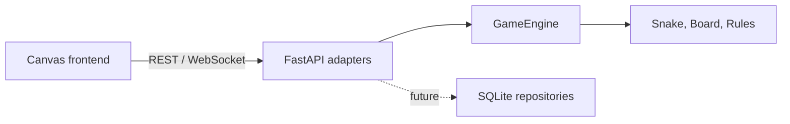

# Snakebite architecture

Snakebite starts as a **modular monolith**: one deployable FastAPI application
with strict boundaries between the domain and adapters. This keeps the learning
project easy to run while allowing the game engine to be tested without an HTTP
server or database.

## Boundaries

- `backend/app/domain`: framework-independent game rules.
- `backend/app/models`: Pydantic request and response schemas.
- `backend/app/api`: HTTP and WebSocket transport.
- `backend/app/repositories`: reserved for SQLite persistence in the next slice.
- `backend/tests`: domain and adapter tests.

## Learning note

The engine is deliberately independent of FastAPI. A game loop, a terminal
client, and a WebSocket adapter can all call the same domain operations. A
microservice split would add deployment and networking complexity without
helping the first playable version.
