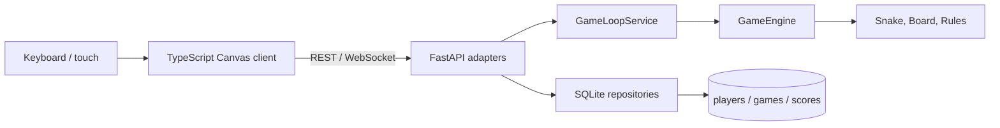

# Snakebite architecture

Snakebite starts as a **modular monolith**: one deployable FastAPI application
with strict boundaries between the domain and adapters. This keeps the learning
project easy to run while allowing the game engine to be tested without an HTTP
server or database.

## Boundaries

- `backend/app/domain`: framework-independent game rules.
- `backend/app/models`: Pydantic request and response schemas.
- `backend/app/api`: HTTP and WebSocket transport.
- `backend/app/services`: async game timing and observer coordination.
- `backend/app/repositories`: async SQLite connection and schema boundary.
- `backend/app/services/persistence.py`: game lifecycle and leaderboard writes.
- `backend/tests`: domain and adapter tests.
- `frontend/src/main.ts`: browser state synchronization, controls, and rendering.
- `frontend/vite.config.ts`: development proxy from the browser to FastAPI.

## State flow

1. The browser opens `/ws/game` and receives the current authoritative state.
2. Keyboard or direction-pad input sends a direction intention.
3. FastAPI starts one `GameLoopService` task for the application lifecycle.
4. The service advances the engine at a fixed interval and signals observers.
5. WebSocket adapters broadcast the latest complete state snapshot.
6. Canvas redraws only from the returned snapshot.

The browser never calculates collisions, scores, growth, or food placement.
Update queues hold at most one signal, so a slow observer receives the latest
state without accumulating stale frames or affecting the game speed.

## Speed and obstacles

The tick interval is derived from a player-selected difficulty, 1 through 5,
sent once with `POST /game/start`. The engine owns the speed table, so the
browser cannot accelerate or slow the simulation by changing its own timing.
Per-level acceleration is bounded by a floor relative to the chosen base, which
keeps the gentlest setting genuinely gentle at every level.

Obstacles are generated by the domain layer per level and published in the
state snapshot as a list of coordinates. Two invariants are enforced where the
layout is built, not in the renderer: the spawn corridor stays clear, and every
open cell remains reachable. A layout applied mid-game subtracts the current
snake body, so levelling up can never kill the player instantly.

The game loop sleeps on a separate, shorter idle interval when no game is
running, so a slow difficulty does not delay demo-mode detection.

## Learning note

The engine is deliberately independent of FastAPI. A game loop, a terminal
client, and a WebSocket adapter can all call the same domain operations. A
microservice split would add deployment and networking complexity without
helping the first playable version.

The application service uses an async lock to serialize player input and timed
movement. It publishes lightweight signals rather than importing WebSocket
types, preserving the boundary between coordination and transport.

SQLite is intentionally local for this phase. `DATABASE_URL` is loaded from
the environment or an ignored `.env` file, and the default local database has
no credentials. A future managed database can use the same setting without
putting secrets in source control.

Canvas is used instead of a frontend game framework because the game is a small
fixed grid with no physics, scene graph, or asset pipeline. This makes the
rendering loop visible to learners and keeps game rules in Python rather than
duplicating them in TypeScript.
