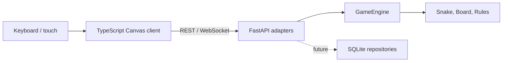

# Snakebite architecture

Snakebite starts as a **modular monolith**: one deployable FastAPI application
with strict boundaries between the domain and adapters. This keeps the learning
project easy to run while allowing the game engine to be tested without an HTTP
server or database.

## Boundaries

- `backend/app/domain`: framework-independent game rules.
- `backend/app/models`: Pydantic request and response schemas.
- `backend/app/api`: HTTP and WebSocket transport.
- `backend/app/repositories`: reserved for SQLite persistence in the next slice.
- `backend/tests`: domain and adapter tests.
- `frontend/src/main.ts`: browser state synchronization, controls, and rendering.
- `frontend/vite.config.ts`: development proxy from the browser to FastAPI.

## State flow

1. The browser opens `/ws/game` and receives the current authoritative state.
2. Keyboard or direction-pad input sends a direction intention.
3. The temporary browser timer sends tick messages at a fixed interval.
4. The backend applies rules and returns a complete state snapshot.
5. Canvas redraws only from the returned snapshot.

The browser never calculates collisions, scores, growth, or food placement.
Moving tick ownership into a backend game-loop service is the next networking
step and will allow several observers without increasing the game speed.

## Learning note

The engine is deliberately independent of FastAPI. A game loop, a terminal
client, and a WebSocket adapter can all call the same domain operations. A
microservice split would add deployment and networking complexity without
helping the first playable version.

Canvas is used instead of a frontend game framework because the game is a small
fixed grid with no physics, scene graph, or asset pipeline. This makes the
rendering loop visible to learners and keeps game rules in Python rather than
duplicating them in TypeScript.
